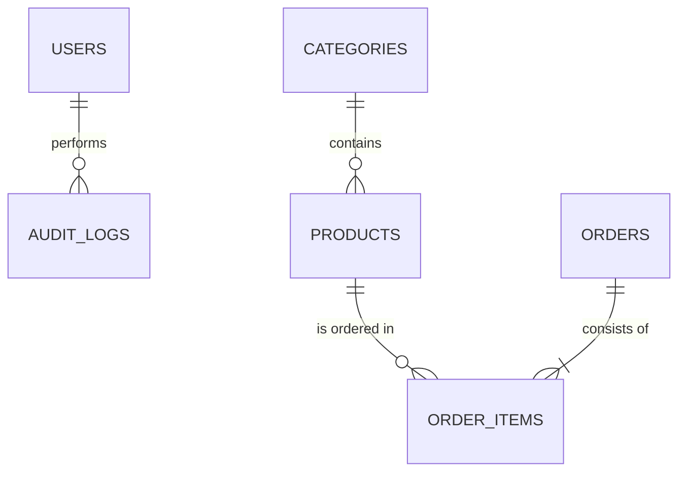

# 1-7 Database Schema - Simple E-commerce Catalogue

DBMS: **PostgreSQL 15**. Files:
- `1-7_schema.sql` - tables, keys, constraints, indexes, triggers
- `1-7_seed_data.sql` - demo data (fictional)

Both files are mounted into `/docker-entrypoint-initdb.d/` and run automatically
the **first** time the database container starts with an empty volume.

## 1. Entity-relationship diagram

```
 users 1 ──────< audit_logs              (user_id, NULL = guest action)

 categories 1 ──────< products 1 ──────< order_items >────── 1 orders

 settings  (key / value, no relations)
```



## 2. Tables

### users
| Column        | Type          | Rules                                         |
|---------------|---------------|-----------------------------------------------|
| id            | SERIAL        | primary key                                   |
| full_name     | VARCHAR(100)  | NOT NULL                                      |
| email         | VARCHAR(150)  | NOT NULL, UNIQUE                              |
| role          | VARCHAR(20)   | `admin` or `standard` (CHECK)                 |
| password_hash | VARCHAR(255)  | PBKDF2 hash, NULL until set from `.env`       |
| is_active     | BOOLEAN       | default TRUE                                  |
| created_at / updated_at | TIMESTAMPTZ | default NOW(), `updated_at` by trigger |

Guests do not have rows in `users` - they use the shop without an account.

### categories
| Column      | Type         | Rules                 |
|-------------|--------------|-----------------------|
| id          | SERIAL       | primary key           |
| name        | VARCHAR(80)  | NOT NULL, UNIQUE      |
| description | VARCHAR(500) | default ''            |
| created_at / updated_at | TIMESTAMPTZ | audit fields |

### products
| Column      | Type          | Rules                                              |
|-------------|---------------|----------------------------------------------------|
| id          | SERIAL        | primary key                                        |
| category_id | INTEGER       | FK -> categories(id), `ON DELETE RESTRICT`         |
| name        | VARCHAR(120)  | NOT NULL                                           |
| sku         | VARCHAR(40)   | NOT NULL, UNIQUE (stock keeping unit, e.g. EL-001) |
| description | TEXT          | default ''                                         |
| price       | NUMERIC(10,2) | CHECK price > 0                                    |
| stock       | INTEGER       | CHECK stock >= 0                                   |
| status      | VARCHAR(20)   | **status field**: `draft`, `active`, `archived`    |
| created_at / updated_at | TIMESTAMPTZ | audit fields                         |

Status meaning: `draft` - prepared but hidden; `active` - visible in the public catalogue;
`archived` - "deleted" (soft delete), hidden but kept for old orders.

### orders
| Column           | Type          | Rules                                                            |
|------------------|---------------|------------------------------------------------------------------|
| id               | SERIAL        | primary key                                                      |
| customer_name    | VARCHAR(100)  | NOT NULL                                                         |
| customer_email   | VARCHAR(150)  | NOT NULL                                                         |
| customer_phone   | VARCHAR(30)   | optional                                                         |
| shipping_address | VARCHAR(300)  | NOT NULL                                                         |
| comment          | VARCHAR(500)  | optional                                                         |
| total_amount     | NUMERIC(12,2) | CHECK >= 0, calculated by the backend                            |
| status           | VARCHAR(20)   | **status field**: `new`, `confirmed`, `shipped`, `completed`, `cancelled` |
| created_at / updated_at | TIMESTAMPTZ | audit fields                                               |

Recommended workflow: `new -> confirmed -> shipped -> completed`, or `cancelled` at any time.
While an order is not final, staff may set any status (e.g. to correct a mistake).
`completed` and `cancelled` are **final** and cannot be changed. Cancelling returns the items to stock.

### order_items
| Column       | Type          | Rules                                         |
|--------------|---------------|-----------------------------------------------|
| id           | SERIAL        | primary key                                   |
| order_id     | INTEGER       | FK -> orders(id), `ON DELETE CASCADE`         |
| product_id   | INTEGER       | FK -> products(id), `ON DELETE RESTRICT`      |
| product_name | VARCHAR(120)  | snapshot of the name at order time            |
| unit_price   | NUMERIC(10,2) | snapshot of the price at order time           |
| quantity     | INTEGER       | CHECK > 0                                     |
| line_total   | NUMERIC(12,2) | unit_price * quantity                         |
| created_at / updated_at | TIMESTAMPTZ | audit fields                    |

Why a snapshot? If the product price changes tomorrow, yesterday's order must still show the old price.

### settings
Key/value table: `store_name`, `contact_email`, `currency`, `low_stock_threshold`.
Edited by the administrator in the admin panel.

### audit_logs
| Column      | Type        | Rules                                               |
|-------------|-------------|-----------------------------------------------------|
| id          | SERIAL      | primary key                                         |
| user_id     | INTEGER     | FK -> users(id), `ON DELETE SET NULL`, NULL = guest |
| action      | VARCHAR(50) | `create`, `update`, `archive`, `delete`, `status_change`, `login` |
| entity_name | VARCHAR(50) | table name, e.g. `products`                         |
| entity_id   | INTEGER     | id of the changed row (NULL for settings)           |
| created_at  | TIMESTAMPTZ | default NOW()                                       |

## 3. Indexes

| Index                         | Purpose                                             |
|-------------------------------|-----------------------------------------------------|
| `idx_products_category`       | filter catalogue by category                        |
| `idx_products_status`         | show only `active` products                         |
| `idx_products_name` (LOWER)   | case-insensitive name search / sorting              |
| `idx_orders_status`           | filter orders by status                             |
| `idx_orders_created_at`       | newest orders first (dashboard, list)               |
| `idx_orders_email` (LOWER)    | search orders by customer e-mail                    |
| `idx_order_items_order`       | load items of an order                              |
| `idx_order_items_product`     | check if a product was ordered                      |
| `idx_audit_logs_entity`       | history of one record                               |
| `idx_audit_logs_created_at`   | latest audit records                                |
| UNIQUE on `users.email`, `categories.name`, `products.sku` | prevent duplicates (also create indexes) |

## 4. Automatic `updated_at`
The function `set_updated_at()` and a `BEFORE UPDATE` trigger on each table set
`updated_at = NOW()` on every update, so the application code cannot forget it.

## 5. Seed data
- 2 users: `admin@example.local` (admin), `staff@example.local` (standard), **without passwords**.
  The backend sets the password hashes on first start from `DEMO_ADMIN_PASSWORD` / `DEMO_STAFF_PASSWORD`.
- 5 categories, 15 products (14 active, 1 draft; some with low or zero stock to show warnings).
- 3 demo orders with items and audit records; 4 settings.

## 6. Useful queries for the defence
```sql
-- Products per category
SELECT c.name, COUNT(p.id) FROM categories c LEFT JOIN products p ON p.category_id = c.id GROUP BY c.name;

-- Order with its items
SELECT o.id, o.status, oi.product_name, oi.quantity, oi.line_total
FROM orders o JOIN order_items oi ON oi.order_id = o.id WHERE o.id = 1;

-- Latest audit records with user e-mail
SELECT a.created_at, COALESCE(u.email, 'guest'), a.action, a.entity_name, a.entity_id
FROM audit_logs a LEFT JOIN users u ON u.id = a.user_id ORDER BY a.created_at DESC LIMIT 10;
```
